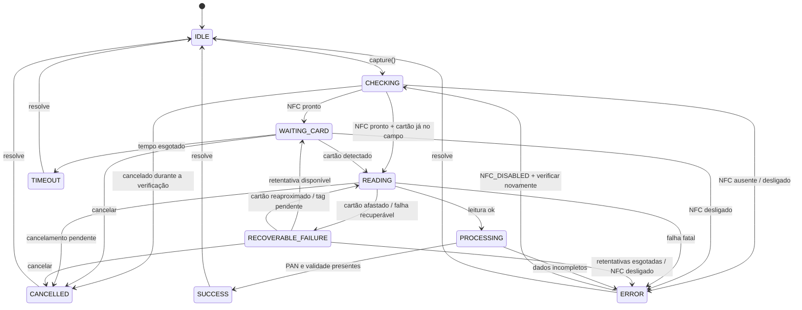

# Diário de decisões — CashTap

<!--
Modelo de entrada:

## DNNN — <título curto>  (AAAA-MM-DD · TNN)
**Contexto:** o problema ou a restrição
**Decisão:** o que foi escolhido
**Alternativas:** o que foi descartado e por quê
**Consequências:** o que isso facilita e o que custa
**Evidência:** bytes, logs, links (quando houver)
-->

## D001 — Repositório único: biblioteca + app de exemplo  (2026-10-26 · T01)

**Contexto:** o projeto começou com um app de testes avulso (`CashTapPlayground`, RN 0.87) usado para validar o ambiente. O entregável do TCC, porém, é uma biblioteca (`react-native-cashtap`) consumida por apps de terceiros, e a banca precisa ver a biblioteca e uma integração funcionando, com o histórico de desenvolvimento das duas.

**Decisão:** um único repositório, gerado pelo `create-react-native-library` (Turbo Module, RN 0.88, Nova Arquitetura), contendo a biblioteca na raiz e o app hospedeiro em `example/`. O `example/` é o app demonstrado na defesa e a entrega da T27. O `CashTapPlayground` é descartado e não é versionado.

**Alternativas:**
- *Biblioteca dentro do Playground* — descartada: mistura o código do SDK com o de um app específico e induz acoplamento da lib ao hospedeiro; repositório git aninhado complica o versionamento.
- *Dois repositórios (lib + app)* — descartada: divide o histórico e o `DECISIONS.md`, exige publicar ou linkar o pacote a cada mudança e dobra o custo de manutenção sem benefício para o TCC.

**Consequências:**
- Código, histórico, issues e decisões ficam num só lugar; a banca enxerga tudo junto.
- O `example/` consome a lib pelo código-fonte (workspace), com rebuild imediato a cada mudança.
- Custo: o `example/` não exercita o pacote como um integrador real o recebe (o que entra no `files` do `package.json`, build em `lib/`, autolinking a partir do `node_modules`). Uma instalação do pacote empacotado (`npm pack`) num app externo fica registrada como validação futura, depois da T27.
- Regra derivada: a lib nunca depende de nada do `example/`. A dependência só vai no sentido example → lib.

**Evidência:** estrutura gerada pelo `create-react-native-library` (commit `c898a27`); app de exemplo executado em dispositivo Android físico com NFC.

---

## D002 — Escopo restrito a Android; iOS fora do projeto  (2026-10-26 · T01)

**Contexto:** o SDK precisa conduzir o diálogo EMV completo com o cartão (SELECT PPSE → SELECT AID → GPO → READ RECORD) e devolver ao app dados do cartão (`pan`, `validade`, `bandeira`, `aid`). Isso exige que o código do app envie e receba APDUs arbitrárias para o chip do cartão.

**Decisão:** o SDK é implementado e suportado apenas em Android. O lado iOS gerado pelo template fica sem implementação e é declarado como não suportado na documentação.

**Alternativas:**
- *Core NFC (`NFCTagReaderSession` + `NFCISO7816Tag`)* — descartada. O Core NFC permite falar ISO 7816 apenas com aplicações cujos AIDs estejam declarados no `Info.plist` (`com.apple.developer.nfc.readersession.iso7816.select-identifiers`), e a Apple não libera a leitura de cartões de pagamento por esse caminho: AIDs de pagamento (Visa `A000000003…`, Mastercard `A000000004…`, PPSE `2PAY.SYS.DDF01`) são bloqueados para apps de terceiros. A API existe, mas não alcança o cartão que nos interessa.
- *Tap to Pay on iPhone (framework ProximityReader)* — descartada. É o único caminho oficial para aceitar cartões por aproximação no iPhone, mas exige entitlement concedido pela Apple e integração com um PSP parceiro habilitado. A leitura é feita pelo próprio sistema, com o componente seguro do aparelho, e os dados do cartão saem cifrados diretamente para o PSP: o app nunca vê PAN, validade nem as APDUs. Isso é incompatível com o objetivo do TCC (implementar o diálogo EMV e o parser) e com o contrato de saída do SDK.
- *APIs de NFC/Secure Element para pagamentos (iOS 17.4+ / 18.1+)* — não se aplicam: servem para o iPhone *emular* um cartão (o celular paga), não para *ler* um cartão (o celular cobra), além de exigirem acordo comercial com a Apple e estarem restritas a algumas regiões.

**Consequências:**
- No Android, `NfcAdapter.enableReaderMode` + `IsoDep.transceive` dão acesso direto a APDUs com qualquer cartão ISO-DEP, sem autorização prévia da plataforma. É isso que viabiliza o projeto.
- O público-alvo do SDK fica limitado a aparelhos Android com NFC.
- O limite é da plataforma, não técnico: com acesso equivalente ao do Android, o núcleo (bytes, APDU, TLV, EMV) seria reaproveitável.
- O tema volta no README (T30) e no capítulo de limitações do TCC.

**Evidência:** documentação Apple — Core NFC (`developer.apple.com/documentation/corenfc`) e ProximityReader / Tap to Pay on iPhone (`developer.apple.com/tap-to-pay/`). *Pendente:* anexar o trecho exato da documentação/guideline sobre o bloqueio de AIDs de pagamento no Core NFC.

---

## D003 — Remoção do suporte web do template  (2026-10-29 · T03)

**Contexto:** o `create-react-native-library` gerou o projeto com suporte a web: implementação alternativa em JS puro (`multiply.tsx` ao lado de `multiply.native.tsx`), build do example com Vite (`vite.config.mjs`, `index.html`, `react-native-web`, `react-dom`) e um job `build-web` no CI. NFC não existe no navegador e o escopo já é só Android (D002).

**Decisão:** remover todo o suporte web: arquivos do Vite, dependências web do example, scripts `web`/`build:web`, bloco `document` do `example/index.js` e o job `build-web` do CI. A API pública tem só a implementação nativa.

**Alternativas:**
- *Manter um stub web que devolve `UNSUPPORTED`* — descartada: mantém um alvo de build e um conjunto de dependências que ninguém vai usar nem testar, só para responder "não suportado".

**Consequências:** menos dependências e menos superfície de build no example e no CI. Importar o pacote num app web passa a falhar na carga do módulo nativo, o que é o comportamento esperado para uma plataforma fora do escopo.

---

## D004 — Example compilado só para ABIs ARM; sem emulador  (2026-10-29 · T03)

**Contexto:** `reactNativeArchitectures` define para quais processadores o C++ do React Native é compilado no app de exemplo. As ABIs `x86`/`x86_64` só servem ao emulador, e o emulador do Android não emula o rádio NFC, então não executa o fluxo do SDK.

**Decisão:** o example compila apenas `armeabi-v7a,arm64-v8a` (`example/android/gradle.properties`). Desenvolvimento e ensaios são feitos em dispositivo físico.

**Alternativas:**
- *Manter as quatro ABIs e usar `--active-arch-only` no dia a dia* — descartada pela simplicidade: o build completo do example não precisa gerar binários de emulador.

**Consequências:**
- A configuração vale **só para o app de exemplo**. Ela não é publicada no pacote (o `example/` fica fora do `files` do `package.json`) e não afeta o integrador.
- A lib é Kotlin puro: compila para bytecode, independente de processador, e não entrega binário nativo (`.so`). Por isso não impõe restrição de ABI a quem a instala, e o app do integrador continua rodando em emulador.
- Requisito derivado para o SDK: em aparelho sem NFC (emulador incluído), responder `UNSUPPORTED` e nunca crashar, para não impedir o integrador de usar o emulador no resto do app (T07).
- Quando for necessário testar o caminho `UNSUPPORTED` no emulador: `yarn example android -PreactNativeArchitectures=x86_64` (ou reverter a linha).
- Se o SDK um dia passar a entregar código C++/`.so`, deve incluir todas as ABIs, inclusive as de emulador.

---

## D005 — JDK 17 para o build Android  (2026-10-29 · T03)

**Contexto:** o Android Studio gerou `example/android/gradle/gradle-daemon-jvm.properties` fixando o JDK do daemon do Gradle em 25, com download automático. O terminal usa o JDK 17 (`JAVA_HOME` via SDKMAN). O plugin Gradle do React Native 0.88 compila Kotlin e Java com toolchain 17 (`jvmToolchain(17)`, `JavaVersion.VERSION_17` em `JdkConfiguratorUtils.kt`).

**Decisão:** JDK 17 em todos os ambientes (terminal, Android Studio e CI), via `JAVA_HOME`. O arquivo de critérios do daemon foi removido e o Gradle JDK do Android Studio aponta para o `JAVA_HOME`.

**Alternativas:**
- *JDK 25 (LTS mais recente)* — descartada: o JDK só roda o build, o app executa no ART do aparelho, então não há ganho para o produto. O toolchain do RN continua exigindo 17, e versões acima do testado pelo RN são fonte conhecida de erros de build.
- *Versionar o `gradle-daemon-jvm.properties` com 17* — adiada: torna o build reproduzível sem depender do `JAVA_HOME`, mas acrescenta download automático de JDK e foge do template do RN. Reavaliar se o CI ou outra máquina divergir.

**Consequências:** build igual no terminal e na IDE; atualização do JDK acompanha a versão indicada pelo React Native, não o lançamento mais recente do Java.

---

## D006 — API pública em inglês; mensagens ao operador em pt-BR  (2026-11-21 · F0)

**Contexto:** o Apêndice A do TCC descreve a interface em português (`capturar`, `CapturaParams`, `status: "sucesso"`), enquanto a especificação técnica já usa inglês nos estados (`WAITING_CARD`) e nos códigos de erro (`CARD_REMOVED`). O pacote se apresenta como SDK de mercado.

**Decisão:** identificadores públicos em inglês (`capture`, `CaptureParams`, `CaptureResult`, `status: 'success' | 'cancelled' | 'timeout' | 'error'`). Textos mostrados ao operador continuam em pt-BR, centralizados no catálogo de erros e no tema. A equivalência com o Apêndice A está em `docs/especificacao.md`, e o apêndice é atualizado com a interface final.

**Alternativas:**
- *Português, como o Apêndice A* — descartada: foge do padrão de SDK publicado em npm e resultaria numa API mista, já que estados e códigos de erro estão em inglês na especificação.

**Consequências:** API consistente e familiar ao integrador; o Apêndice A precisa de revisão (já prevista no próprio texto do TCC).

---

## D007 — Processo de entrega: fases com gate de QA e Tech Lead  (2026-11-21 · F0)

**Contexto:** o projeto passou de mentoria task a task para entrega completa com prazo curto, com a implementação feita pelo Claude e a validação física pelo autor.

**Decisão:** cada fase da especificação (F1..F8) é uma branch e um PR. Antes do merge, dois agentes revisores precisam aprovar: `qa` (executa toda a bateria de testes e builds e rastreia cada critério de aceite a um teste) e `tech-lead` (revisa o diff contra as regras do projeto e padrões de SDK). As regras ficam em `.claude/rules/`, os agentes em `.claude/agents/`. Issues cujo critério depende de celular e cartão ficam abertas com o label `validar-no-device` até o teste físico.

**Alternativas:**
- *Commits direto na `main`* — descartada: perde a trilha de revisão, que também é evidência do processo para a banca.

**Consequências:** histórico revisado e rastreável; a fase só avança com testes verdes. O que depende de hardware fica explicitamente marcado, sem falsa sensação de pronto.

---

## D008 — Remoção do iOS e guarda de plataforma no TS  (2026-11-21 · F1 · #3)

**Contexto:** o template gerou `ios/`, `Cashtap.podspec`, `example/ios`, `Gemfile` e um job de build iOS no CI. Com a spec do Turbo Module mudando, o `Cashtap.mm` ficaria desatualizado e quebraria o build iOS. A especificação (E1-H1) admite remover a pasta ou deixar um stub.

**Decisão:** remover todo o código e configuração iOS do pacote e do example. O TS acessa o módulo nativo só por `src/native.ts`, que devolve `null` fora do Android (`Platform.OS` + `TurboModuleRegistry.get`, não `getEnforcing`). A API pública responde `UNSUPPORTED` em vez de lançar no import.

**Alternativas:**
- *Stub iOS que rejeita "não suportado"* — descartada: manteria Podspec, Xcode project e job de CI só para dizer "não", e o stub teria que acompanhar cada mudança da spec.

**Consequências:** um app iOS que instale o pacote recebe `UNSUPPORTED` em tempo de execução, sem crash. O integrador multiplataforma pode chamar a API sem `if (Platform.OS)`. *Não verificado:* que o build de um app iOS hospedeiro não seja afetado pelo `codegenConfig` da lib — fica como validação futura, junto do teste com `npm pack` previsto na D001.

---

## D009 — Evento `onNfcStatusChange` e eventos tipados do Codegen  (2026-11-21 · F1 · #5)

**Contexto:** a F1 exige um evento nativo → JS. A especificação §2.4 sugere o padrão antigo `addListener`/`removeListeners` + `NativeEventEmitter`. A RN 0.76+ oferece `CodegenTypes.EventEmitter<T>` na spec, que gera `emitOnX` tipado na classe base Kotlin.

**Decisão:** usar `CodegenTypes.EventEmitter`. O primeiro evento é `onNfcStatusChange`, alimentado pelo `NfcStateMonitor` (`BroadcastReceiver` de `NfcAdapter.ACTION_ADAPTER_STATE_CHANGED`), removido no `invalidate()`. Emite só em `STATE_ON`/`STATE_OFF` e só quando o status muda. Ele também atende RN-02: quando o operador liga o NFC nas configurações, a UI reverifica sozinha. Exposto na API pública como `onNfcStatusChange(listener): Unsubscribe`.

**Registro do receiver no Android 13+:** `RECEIVER_EXPORTED`. O broadcast é enviado pelo serviço NFC (`com.android.nfc`, UID `nfc`), não pelo `system_server`; um receiver `RECEIVER_NOT_EXPORTED` só recebe de root, `SYSTEM_UID` ou do próprio app, então o evento não chegaria. Exportar é seguro porque `android.nfc.action.ADAPTER_STATE_CHANGED` é `protected-broadcast`: nenhum app de terceiro consegue enviá-lo. (Apontado na revisão do Tech Lead da F1; a primeira versão usava `RECEIVER_NOT_EXPORTED`.)

**Alternativas:**
- *`addListener`/`removeListeners` + `NativeEventEmitter`* — descartada: sem tipagem do payload, nomes de evento como strings soltas e dois métodos de spec só de infraestrutura.
- *Evento de teste artificial* — descartado: código sem uso em produção.

**Consequências:** eventos com payload tipado e validado na fronteira; `subscription.remove()` desfaz a assinatura (teste em `src/__tests__/native.test.ts`). A superfície pública ganha uma função, justificada pelo uso real.

---

## D010 — `openNfcSettings` público e erro explícito de instalação  (2026-11-21 · F1 · #3)

**Contexto:** RN-02 pede que o SDK oriente o operador a ligar o NFC e ofereça reverificação. A revisão da F1 apontou ainda que, no Android, um módulo nativo não linkado (pacote instalado sem rebuild, autolinking quebrado) fazia a API responder `UNSUPPORTED` — o que viraria a mensagem "Este aparelho não possui NFC" para o operador.

**Decisão:**
- `openNfcSettings()` entra na API pública: abre `Settings.ACTION_NFC_SETTINGS` a partir da Activity atual (ou do contexto da aplicação com `NEW_TASK`), cai para `ACTION_WIRELESS_SETTINGS` e nunca lança se nenhuma tela existir. A UI do SDK usa a mesma função.
- No Android, módulo nativo ausente lança `LINKING_ERROR` com instrução de recompilar. `UNSUPPORTED` fica reservado para "fora do Android" e "aparelho sem NFC".

**Alternativas:**
- *Manter `openNfcSettings` interno à UI* — descartada: o integrador que mostra um indicador de NFC na própria tela precisaria duplicar a lógica de intent.
- *Responder `UNSUPPORTED` também para módulo ausente* — descartada: transforma erro de instalação em diagnóstico falso.

**Consequências:** superfície pública final prevista: `capture`, `cancel`, `getNfcStatus`, `onNfcStatusChange`, `openNfcSettings`, `onStateChange`, `CashTapProvider` (+ tipos). Erro de instalação aparece cedo e com instrução de correção.

---

## D011 — F2, F3 e F4 entregues num único PR  (2026-11-21 · F2–F4)

**Contexto:** a D007 prevê um PR por fase. Sessão NFC (F2), diálogo EMV (F3) e extração de dados (F4) formam uma única operação atômica (`readCard`): o orquestrador depende do extrator e da máscara, e nenhuma das fases é verificável isoladamente no device sem as outras.

**Decisão:** um PR `fase/f2-f4-nucleo-nativo`, com uma rodada de QA + Tech Lead cobrindo as issues #6–#17 e #23.

**Consequências:** uma revisão maior e mais coerente; a trilha por issue continua nos commits e no corpo do PR.

---

## D012 — Reader mode: flags, ciclo de vida e tag de uso único  (2026-11-21 · F2 · #8, #9)

**Contexto:** E2-H2 pede detecção rápida, liberação do rádio e respeito ao ciclo de vida da Activity; E2-H3 pede canal IsoDep fechado em qualquer caminho.

**Decisão:**
- `enableReaderMode` com `FLAG_READER_NFC_A | NFC_B | SKIP_NDEF_CHECK | NO_PLATFORM_SOUNDS`: cartões EMV são ISO 14443 A ou B, não carregam NDEF (checar seria só latência), e o feedback sonoro/tátil é do SDK.
- `NfcSessionManager` usa `currentActivity` no momento do uso, desliga em `onHostPause`, religa em `onHostResume` se a sessão estiver ativa, e se registra/desregistra como `LifecycleEventListener`.
- A `Tag` detectada é entregue **uma vez** (`takeTag`): cada leitura exige uma aproximação, o que torna a retentativa (RN-07) previsível.
- `IsoDepTransceiver`: timeout de 5 s, `TagLostException`/`IOException`/`IllegalStateException` → `LinkLostException` → `CARD_REMOVED`; `close()` em `finally` (RN-11).
- Toda troca de APDU num executor de thread única; `invalidate()` encerra executor, sessão e monitor.

**Alternativas:**
- *`enableForegroundDispatch`* — descartada: entrega a tag via `Intent`/`onNewIntent` da Activity do integrador, exigindo código no app hospedeiro e passando pelo despacho NDEF do sistema.

**Consequências:** o integrador não escreve nada na Activity; o rádio é liberado ao sair do app. Comportamento real de pause/resume só se comprova no device (roteiro F2).

---

## D013 — Valores de terminal no PDOL  (2026-11-21 · F3 · #14)

**Contexto:** o GPO precisa responder ao PDOL com o comprimento exato de cada elemento (RN-16, E3-H4); um byte errado faz o cartão recusar sem explicação (risco nº 1 da especificação).

**Decisão:** `PdolBuilder` preenche: 9F02 com o **valor real** em BCD n12 (a especificação permite zero; o valor real evita recusa por "valor zero" em alguns kernels Visa), 9F03 zero, 9F1A `0076` (Brasil), 5F2A pela moeda informada (`0986`), 95 zero, 9A/9F21 data e hora locais, 9C `00`, 9F37 4 bytes de `SecureRandom`, 9F66 (TTQ) `36004000`, 9F35 `22`, 9F33 `E0F0C8`, 9F40 `6000F0A001`, 9F4E "CashTap". Tag desconhecida vai zerada. Ajuste de comprimento conforme EMV Book 3 §5.4: numérico completa/trunca à esquerda; demais, à direita.

**Alternativas:**
- *Tudo zerado* — descartada como padrão: TTQ zerado não anuncia qVSDC e cartões Visa podem recusar; mantida como comportamento para tags desconhecidas.

**Consequências:** primeiro ponto a revisar se um cartão real responder `6985`/`6984` ao GPO — o diagnóstico mostra o comando GPO completo (só dados do terminal, sem dado do cartão) para conferência no emvlab.

---

## D014 — Seleção de aplicação: prioridade e fallback  (2026-11-21 · F3 · #11, #13)

**Contexto:** RN-13 manda selecionar "a primeira" aplicação suportada do PPSE; RN-15 manda tentar AIDs conhecidos quando o PPSE responde `6A82`.

**Decisão:** entre as aplicações suportadas, vale o *Application Priority Indicator* (tag 87, nibble baixo; ausente = menor prioridade) e, no empate, a ordem do diretório. Se o SELECT de uma candidata falhar, tenta a próxima. Fallback (`6A82`): `A0000000031010`, `A0000000032010` (Visa Electron), `A0000000041010`, `A0000000043060` (Maestro) — todos mapeados por RID para Visa/Mastercard (RN-20). PPSE `9000` sem entradas `61` → `PARSE_ERROR`; PPSE com outro SW → `PROTOCOL_ERROR`.

**Alternativas:**
- *Primeira na ordem do diretório, ignorando a 87* — descartada: contraria o EMV Book B quando o emissor declara prioridade; para cartões com uma só aplicação o resultado é idêntico.

**Consequências:** divergência registrada em relação à leitura literal de RN-13 (mais aderente ao EMV). Cartões co-branded (ex.: Elo + Mastercard) escolhem a aplicação suportada.

---

## D015 — Extração: fallbacks além da especificação e validação  (2026-11-21 · F4 · #16)

**Contexto:** RN-18/19 preveem 5A → 57 e 5F24 → 57. Cartões Mastercard em modo contactless podem trazer o Track 2 em `9F6B`; cartões Visa qVSDC costumam trazer o Track 2 (57) já na resposta do GPO, sem registros.

**Decisão:** buscar em GPO + registros; PAN: 5A → 57 → 9F6B; validade: 5F24 → 57/9F6B. PAN validado (12–19 dígitos, Luhn) e validade validada (mês 01–12): falha vira `PARSE_ERROR` (recuperável), ausência vira `INCOMPLETE_DATA` (RN-21). O resultado atravessa a ponte como JSON e é revalidado no TS (`parseCardRead`) antes de chegar à máquina de estados (INV-4).

**Consequências:** leitura corrompida por afastamento parcial é rejeitada em vez de devolver PAN errado. Track 2 presente mas sem separador/validade também é `PARSE_ERROR` (recuperável), salvo quando 5A e 5F24 já bastam.

**RN-26 (zeragem):** ao fim de toda leitura (sucesso ou falha), o orquestrador sobrescreve com zero todas as respostas brutas recebidas, os buffers montados por `GET RESPONSE` e o valor e cabeçalho de **todos** os TLVs decodificados (`Tlv.wipe()`, recursivo). Limitação: o PAN e a validade viram `String` (JVM) e depois `string` (JS) para chegar ao integrador; strings são imutáveis e ficam a cargo do coletor de lixo. `CardReadResult` e `ExtractedCardData` sobrescrevem `toString()` para nunca imprimir o PAN.

---

## D016 — Tratamento de 61xx/6Cxx e mascaramento do diagnóstico  (2026-11-21 · F3/F4 · #10, #23)

**Decisão:**
- ISO 7816-4: `6Cxx` → reenvia com `Le = xx`; `61xx` → `GET RESPONSE` até 16 vezes, concatenando os dados. Raro em ISO-DEP (T=CL), mas barato e evita falha espúria.
- Diagnóstico por **allowlist** (`EmvTags.DIAGNOSTIC_CLEAR`): comandos saem em claro (só dados do terminal e AIDs públicos); nas respostas, a estrutura (tag + comprimento) é sempre exibida, objetos construídos são percorridos, e o valor de um objeto primitivo só aparece se a tag estiver na allowlist (diretório, AIP, AFL, PDOL/CDOL, validade, ATC, CVM list etc.). Todo o resto vira `**` por byte — inclusive tags que o SDK não conhece. Resposta que não é TLV válido aparece só como tamanho. O criptograma aparece apenas como `cryptogramPresent: true/false` (RN-27).
- Mensagens de erro do parser citam só posições (offset), nunca bytes lidos: num parse desalinhado, "tag" e "comprimento" seriam dígitos do PAN.

**Alternativas:**
- *Denylist das tags sensíveis* (primeira versão) — descartada na revisão do Tech Lead: o certificado da chave pública do ICC (`9F46`, presente em cartões com DDA/CDA) contém o PAN recuperável com a chave pública da CA, que é pública. Qualquer tag esquecida na denylist vaza; na allowlist, esquecer uma tag só esconde informação.

**Referências:** OWASP Mobile Top 10 (2024) M6 — controles de privacidade inadequados e M9 — armazenamento inseguro; PCI DSS v4.0 req. 3.4.1 — exibição do PAN mascarada, no máximo BIN (6) + últimos 4 dígitos, que é o formato de `panMasked`.

**Consequências:** a tela de diagnóstico pode ser mostrada à banca e exportada sem expor dados do portador; ainda permite conferir estrutura e SW de cada etapa no emvlab.

---

## D017 — Contrato de sessão nativa e seleção robusta  (2026-11-21 · F2–F4 · #9, #13, #14)

**Contexto:** a revisão apontou três comportamentos que precisam de contrato explícito antes da máquina de estados (F5): cartão que sai e volta durante a leitura, cancelamento no meio do diálogo e respostas de GPO que significam "use outra aplicação".

**Decisão:**
- **Unidade atômica = cada APDU.** `cancelRead` é verificado antes de cada comando; uma troca nunca é interrompida. Consequência: a leitura pode terminar com sucesso depois do pedido de cancelamento, e a máquina de estados trata isso como CANCELLED (RN-10).
- **Tag pendente.** O reader mode continua ligado durante a leitura; `onTagDetected` pode chegar em READING. O nativo guarda sempre a tag mais recente; a máquina de estados registra a detecção e, se a leitura em curso falhar de forma recuperável, lê de novo sem exigir nova aproximação.
- **Não desligar o reader mode durante a leitura** (`stopReaderMode` derruba o IsoDep → `CARD_REMOVED` falso); só nos estados terminais.
- **GPO `6984`/`6985`/`6986`** → descarta a aplicação e tenta a próxima candidata (Entry Point, Book B). Todas recusadas → `PROTOCOL_ERROR`.
- **PPSE `6D00`/`6E00`/`6A81`** → `UNSUPPORTED_BRAND`: cartão ISO-DEP que não é de pagamento (crachá, transporte), sem gastar retentativas.
- **PDOL > 252 bytes** → `PARSE_ERROR`; de 128 a 252 bytes, template `83 81 xx` (BER longo).
- **`readCard`** valida os parâmetros do terminal antes de tocar no rádio, garante resolução única da Promise em qualquer caminho (inclusive módulo invalidado e `Throwable`), e rejeita leitura concorrente com detail `READ_IN_PROGRESS`.
- A permissão `VIBRATE` sai do manifesto até a F6, que é quem a usa.

**Consequências:** o contrato está documentado em `src/NativeCashtap.ts` e é a base dos testes da máquina de estados.

---

## D018 — Máquina de estados: núcleo puro, runner e extensões à tabela §4.2  (2026-11-21 · F5 · #18–#22)

**Contexto:** a especificação define 10 estados, a tabela de transições e INV-1..5. Alguns casos reais não estão na tabela: cartão que volta enquanto a tela de falha está aberta, cartão que volta durante a leitura (D017), cancelamento durante a verificação do NFC, NFC desligado com a tela aberta e como encerrar com o NFC desligado (RN-02).

**Decisão — modelo:**
- `src/core/machine.ts` é uma função pura `transition(snapshot, event) → { snapshot, effects }`. O snapshot é uma **união discriminada por estado**: `PROCESSING`/`SUCCESS` carregam o cartão, `RECOVERABLE_FAILURE`/`TIMEOUT`/`ERROR` carregam o erro, os demais não carregam nenhum dos dois — "SUCCESS sem cartão" ou "IDLE com cartão" não compilam (#19).
- O `CaptureSession` (runner) executa os efeitos. O nativo é injetado por `NativePort`, o equivalente no TS do `Transceiver` do Kotlin (T18).

**Decisão — extensões à tabela, todas testadas:**
- `RECOVERABLE_FAILURE` + cartão detectado → `READING`, se houver retentativa disponível.
- `READING` + cartão detectado → "tag pendente"; se a leitura falhar de forma recuperável, lê de novo na hora (D017). `CHECKING` + cartão detectado → lê assim que o NFC ficar pronto.
- `CHECKING` + cancelar → efetivado quando o NFC responder, **qualquer** que seja a resposta (pronto ou indisponível) — quem desistiu não fica esperando.
- `WAITING_CARD`/`RECOVERABLE_FAILURE` + NFC desligado pelo operador → `ERROR(NFC_DISABLED)` na hora, em vez de esperar o timeout.
- `ERROR(NFC_DISABLED)` não encerra sozinho: "verificar novamente" (`RECHECK`, também disparado quando o NFC é ligado) volta a `CHECKING` com as flags limpas; cancelar ou "fechar" resolve com `NFC_DISABLED` (RN-02). `ERROR(NFC_UNSUPPORTED)` encerra na hora e a UI não abre (RN-01).
- **Cancelamento por estado** (#21): imediato em `WAITING_CARD` e `RECOVERABLE_FAILURE`; diferido em `CHECKING` e `READING` (RN-10); **ignorado** em `PROCESSING` e nos estados finais, porque a leitura já concluiu e o resultado é entregue — cancelar tarde não desfaz uma leitura.

**Decisão — runner:**
- Eventos processados em **fila**, um por vez: listener ou efeito que dispara outro evento (ex.: `cancel()` dentro de `onStateChange`) não causa reentrância nem notificação fora de ordem. Os efeitos de um evento rodam **antes** de os listeners serem notificados.
- Exceção em listener do integrador é isolada (logada em `__DEV__`); Promise nativa rejeitada ou efeito que lança vira erro `UNKNOWN` no fluxo. A Promise de `capture()` sempre resolve (INV-3) e o SDK nunca fica preso em `ALREADY_RUNNING`.
- A UI recebe uma **projeção** da sessão (`ActiveSession`): estado, valor, contadores, erro e cartão **mascarado**. O PAN completo só existe no resultado de `capture()` (RN-24).
- `meta.durationMs` vai do `capture()` até a entrada no estado final — **sem** o tempo de exibição da tela final (sucesso 1,5 s, falha 3 s), para não enviesar `t_total` por desfecho. `readDurationMs` (`t_ciclo`) mede da entrada em `READING` da leitura bem-sucedida até o resultado.
- Falhas automaticamente recuperáveis: `CARD_REMOVED`, `PROTOCOL_ERROR`, `PARSE_ERROR`. Com `maxRetries = N`, a falha N+1 encerra com `READ_FAILED_MAX_RETRIES` (RN-08).

**Decisão — API:**
- Resultado com quatro status: `success`, `cancelled`, `timeout`, `error` (RN-06).
- `capture()` sem `CashTapProvider` montado **rejeita** (erro de integração). Parâmetro inválido e captura concorrente **resolvem** com `INVALID_AMOUNT`/`ALREADY_RUNNING` sem acionar o rádio (RN-03, RN-04). Moeda inválida também é `INVALID_AMOUNT`: é parâmetro da cobrança, e o texto ao operador ("Valor de cobrança inválido.") continua adequado.
- `timeoutMs`/`maxRetries`: ausente ou NaN → padrão; fora da faixa, inclusive ±Infinity → limite mais próximo (RN-05, RN-08).

**Alternativas:**
- *Máquina de estados no Kotlin* — descartada pela especificação §2.3.
- *Biblioteca de statecharts (XState)* — descartada: dependência de runtime para 10 estados; a função pura é varrida exaustivamente nos testes (estado × evento × variações de contexto).

**Consequências:** fluxo inteiro testado sem device (fake timers + nativo simulado), incluindo timeout, retentativa, cancelamento em cada estado, cartão que sai e volta, exceções de integrador e rejeições do nativo. O diagrama acima é a figura da máquina de estados no TCC.

---

# Divergências spec EMV × cartão real

| Data | Cartão | Esperado pela spec | Observado | Hex |
|---|---|---|---|---|
